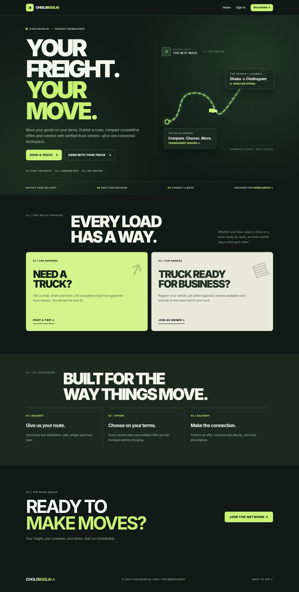
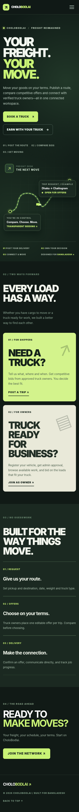
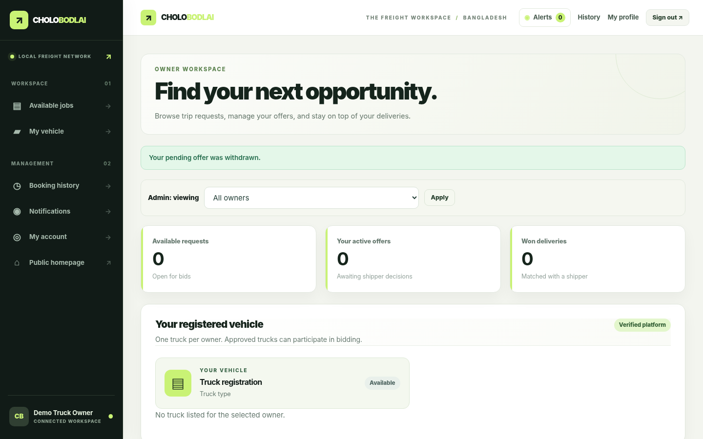
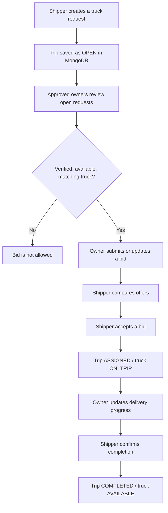
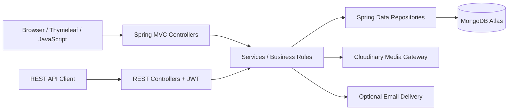

<div align="center">

# 🚚 CholoBodlai

### Request a truck. Compare offers. Move with confidence.

**A truck booking and bidding marketplace built for Bangladesh.**

[](https://www.java.com/)
[](https://spring.io/projects/spring-boot)
[](https://www.mongodb.com/atlas)
[](https://www.thymeleaf.org/)
[](https://www.docker.com/)

[](https://github.com/JubayerIslamCSE/CholoBodlai-V6/actions/workflows/ci.yml)

[🌐 Live deployment](https://cholobodlai-v6.onrender.com/) · [💻 Source code](https://github.com/JubayerIslamCSE/CholoBodlai-V6) · [⚙️ Detailed setup guide](README-START-HERE.md)

</div>

---

## 📖 Overview

**CholoBodlai** connects people and businesses who need to transport goods (**Shippers**) with registered truck owners (**Owners**). Instead of agreeing to a price without comparing options, a shipper can create a trip request, receive bids from eligible owners, select an offer, and manage the delivery from one dashboard.

The application has a third role—**Admin**—responsible for reviewing owner accounts, verifying vehicle documents, and managing platform activity.

It is a **Spring Boot monolithic web application** with server-rendered Thymeleaf pages, a REST API, Spring Security, MongoDB persistence, and Cloudinary media storage.

> **Version note:** This document covers **CholoBodlai V6 before the later redesign**, as found in the linked repository.

> **Project scope:** CholoBodlai implements the core booking workflow for a university/student project. Its map is a **simulation, not live GPS tracking**; fare amounts are estimates and bids, not online payments.

## 🖥️ V6 interface previews (before redesign)

This README documents the **V6 code currently committed to `main`**, including the original Night Drive homepage and existing dashboards. The later TruckLagbe-inspired homepage redesign and proposed `home.css` are **not included** unless you explicitly commit them.

These images are **V6 design previews already included in the repository** and may differ from the currently deployed website.

<p align="center">
  
</p>

<details>
<summary><b>View mobile homepage and owner-dashboard design previews</b></summary>
<br>
<p align="center">
  
  
</p>
</details>

## 👥 User roles

| Role | What the user can do |
|:--|:--|
| **Shipper** 📦 | Register, create and manage trip requests, receive bids, select an offer, track booking progress, view history, and review completed deliveries. |
| **Truck Owner** 🚛 | Register a vehicle, await admin approval, view open opportunities, bid with an eligible truck, manage assigned trips, and update vehicle documents. |
| **Admin** 🛡️ | Approve/reject owners, review replacement documents, manage accounts, inspect activity, and resolve booking disputes. |

### 🔁 How a booking works



**Important rules:**

- A newly registered truck owner must be **approved by an admin** before participating.
- A bid requires a truck that is **verified**, **AVAILABLE**, and matches the requested **truck type ID**.
- Shippers must choose a pickup time at least **48 hours ahead**.
- A truck cannot be assigned to two bookings at the same time; bid acceptance uses conditional MongoDB updates.
- The final accepted bid is distinct from the estimated fare calculated at trip creation.

## ✨ Main features

| Area | Implemented behavior |
|:--|:--|
| **Authentication** | Phone-number login, BCrypt password hashing, role-based authorization, browser sessions, and JWT authentication for REST APIs. |
| **Registration** | Shipper accounts, owner registration with one vehicle, admin approval, and a configurable email-verification requirement. |
| **Trip requests** | Pickup/drop-off, loading date/time, truck type, distance, cargo details, return-trip option, and trip history. |
| **Bidding** | Owners submit or update eligible offers; shippers compare bids and accept an offer. |
| **Fare estimation** | Distance-based rates with a different calculation for return trips. |
| **Delivery workflow** | Booking assignment, delivery status changes, and final shipper confirmation. |
| **Notifications** | MongoDB-backed in-app notifications and unread counts. |
| **Booking interactions** | Private messages for matched participants, printable HTML receipts, disputes, and post-delivery reviews. |
| **Vehicle management** | Vehicle photos, registration documents, verification, and customer reviews. |
| **Demo tracking** | SVG route and truck animation controlled by JavaScript; no actual GPS hardware or live location feed. |
| **Administration** | Owner/document reviews, user suspension/reinstatement, activity statistics, dispute handling, and audit records. |

## 🧰 Tech stack

| Layer | Tools |
|:--|:--|
| Language / runtime | **Java 21** |
| Backend | **Spring Boot 4.1.1**, Spring MVC, Spring Validation |
| Authentication / authorization | **Spring Security**, BCrypt, JWT (JJWT) |
| Frontend | **Thymeleaf**, HTML, CSS, vanilla JavaScript |
| Database | **MongoDB / MongoDB Atlas**, Spring Data MongoDB |
| Media | **Cloudinary** for truck photos and protected document assets |
| Email (optional) | Resend HTTPS API or configured SMTP; development-only mail preview |
| Build and testing | **Maven**, JUnit, QA smoke tests, GitHub Actions |
| Hosting | **Docker** and **Render** |

## 🏗️ Application architecture



**Where to find the code:**

```text
CholoBodlai-V6/
├── pom.xml                         # Dependencies and Java/Spring versions
├── Dockerfile                      # Docker build and runtime
├── render.yaml                     # Optional Render deployment blueprint
├── .env.example                    # Variable names (example values only)
├── .github/workflows/ci.yml       # Automated checks
├── qa/                             # Regression and smoke tests
└── src/
    ├── main/
    │   ├── java/com/jubayer/cholobodlai/
    │   │   ├── CholoBodlaiApplication.java
    │   │   ├── Controller/        # Web + REST endpoints
    │   │   ├── Security/          # Authentication, roles, JWT
    │   │   ├── Service/           # Booking, bidding, media, etc.
    │   │   ├── Repository/        # MongoDB queries
    │   │   ├── Model/             # MongoDB document models
    │   │   ├── DTO/               # Request/response objects
    │   │   ├── Component/         # Fare calculators and notifications
    │   │   ├── Config/            # Spring/MongoDB configuration
    │   │   └── JustToTest/        # Bootstrap / optional demo data
    │   └── resources/
    │       ├── application.properties
    │       ├── templates/         # Thymeleaf HTML pages
    │       └── static/
    │           ├── css/style.css
    │           └── js/           # site.js, tracking.js
    └── test/                       # Java tests
```

**Useful starting points:**

- Trip creation and delivery status: [`TripWebController`](src/main/java/com/jubayer/cholobodlai/Controller/n/TripWebController.java) and [`TripServiceImpl`](src/main/java/com/jubayer/cholobodlai/Service/Trip/TripServiceImpl.java)
- Bid eligibility and acceptance: [`BidServiceImpl`](src/main/java/com/jubayer/cholobodlai/Service/Bid/BidServiceImpl.java)
- Login and role access: [`SecurityConfig`](src/main/java/com/jubayer/cholobodlai/Security/SecurityConfig.java)
- Registration: [`AccountService`](src/main/java/com/jubayer/cholobodlai/Service/AccountService.java)
- Cloudinary storage: [`TruckDocumentStorage`](src/main/java/com/jubayer/cholobodlai/Service/TruckDocumentStorage.java)
- Tracking simulation: [`tracking.html`](src/main/resources/templates/trips/tracking.html) + [`tracking.js`](src/main/resources/static/js/tracking.js)

## 🚀 Run locally

### 1. Prerequisites

- **JDK 21**
- **IntelliJ IDEA** (recommended) or another Java IDE
- **MongoDB Atlas** access (recommended for transactional workflows), or a suitable local MongoDB deployment
- Internet connection to download Maven dependencies
- **Cloudinary account** if you want to test persistent uploads

### 2. Clone the project

```bash
git clone https://github.com/JubayerIslamCSE/CholoBodlai-V6.git
cd CholoBodlai-V6
```

### 3. Configure environment variables

Set these in **IntelliJ → Run → Edit Configurations → Environment variables**, or in your terminal before starting the app.

| Environment variable | Use |
|:--|:--|
| `MONGODB_URI` | Your MongoDB connection URI. Without it, the app defaults to `mongodb://localhost:27017/cholobodlai`. |
| `APP_ADMIN_PHONE` | Admin phone used when bootstrapping a **new** admin account. |
| `APP_ADMIN_PASSWORD` | Strong initial admin password (**10+ characters**). Existing admin passwords are **not reset** on restart. |
| `APP_JWT_SECRET` | Stable random key for JWT tokens (at least 32 UTF-8 bytes). Generate with `openssl rand -hex 32`. |
| `APP_MEDIA_BACKEND` | `cloudinary` for persistent storage; `auto` can use local storage during development. |
| `CLOUDINARY_CLOUD_NAME` | Cloudinary cloud name (needed with Cloudinary backend). |
| `CLOUDINARY_API_KEY` | Cloudinary API key. |
| `CLOUDINARY_API_SECRET` | Cloudinary API secret. |
| `APP_EMAIL_VERIFICATION_REQUIRED` | `false` to allow registration without email verification; `true` to require verification. Current default: `false`. |
| `APP_MAIL_PREVIEW` | `true` for local-only admin mail preview; use `false` on Render. |
| `RESEND_API_KEY` | Optional HTTPS transactional-email key; needed if using Resend to deliver real mail. |
| `APP_MAIL_FROM` | Sender address configured for the email provider. |
| `APP_PUBLIC_BASE_URL` | `http://localhost:8080` locally; actual HTTPS hostname on Render. |
| `APP_DEMO_SEED` | Keep `false` to avoid creating demo users in an empty database. |
| `APP_COOKIE_SECURE` | `false` for HTTP localhost; `true` for HTTPS deployment. |

> 🔐 **Never upload passwords, connection strings containing credentials, `.env` files, or API secrets to GitHub.** [`.env.example`](.env.example) is a checklist of variable names, **not** a file that Spring Boot automatically loads.

**IntelliJ Run/Debug configuration:**

| Field | Value |
|:--|:--|
| Type | `Application` (or `Spring Boot`) |
| Name | `CholoBodlaiApplication` |
| Java SDK | **Java 21** |
| Main class | `com.jubayer.cholobodlai.CholoBodlaiApplication` |
| Working directory | Repository root (the directory containing `pom.xml`) |
| Program arguments / VM options | Leave blank unless specifically needed |
| Environment variables | Set the variables from the table above |

### 4. Start the application

Run `CholoBodlaiApplication` from IntelliJ, **or** run:

```bash
# macOS / Linux
./mvnw spring-boot:run

# Windows PowerShell
.\mvnw.cmd spring-boot:run
```

Once startup succeeds, visit **http://localhost:8080**. Check **http://localhost:8080/ping** for the response `ok`.

## 🌐 Deploy with Render

1. Push the source code to a GitHub repository.
2. In **Render → New → Web Service**, connect the repository and select **Docker** (or use the included [`render.yaml`](render.yaml) Blueprint).
3. Use branch `main`, Dockerfile `./Dockerfile`, and health check `/ping`.
4. Add the **same environment variables** under Render → Environment, including MongoDB and Cloudinary credentials.
5. Set `APP_MEDIA_BACKEND=cloudinary`, `APP_COOKIE_SECURE=true`, `APP_MAIL_PREVIEW=false`, `APP_DEMO_SEED=false`, and `APP_PUBLIC_BASE_URL` to your real HTTPS site URL.
6. Set `APP_EMAIL_VERIFICATION_REQUIRED` according to the signup policy you want; configure real email delivery **before** turning verification on.
7. Deploy, wait until Render reports **Live**, then test registration, owner approval, trip creation, bidding, uploads and delivery completion.

**Note:** Cloudinary stores media persistently; do not rely on Render's ephemeral local filesystem for uploaded truck files. Allow MongoDB Atlas network access for the deployed service as appropriate.

For screen-by-screen instructions, see **[README-START-HERE.md](README-START-HERE.md)**.

## 🧪 Testing and quality checks

```bash
# Java tests
./mvnw test

# Additional tests (macOS/Linux)
sh qa/run-policy-smoke.sh
sh qa/run-cloudinary-smoke.sh

# Browser scroll/navigation regression (Node.js required)
node qa/scroll-regression.test.cjs
```

GitHub Actions runs these checks through [`.github/workflows/ci.yml`](.github/workflows/ci.yml). The existence of tests does **not** imply every live user journey has passed end-to-end testing.

## 🧭 Useful pages

| Page | URL |
|:--|:--|
| Homepage | `/` |
| Register / Login | `/register` · `/login` |
| Shipper dashboard | `/shipper` |
| Request a truck | `/trips/new` |
| Owner dashboard | `/owner` |
| My vehicle | `/trucks` |
| Admin dashboard | `/admin` |
| Trip details and bids | `/trips/{id}` |
| Booking receipt | `/trips/{id}/receipt` |
| Tracking **simulation** | `/trips/{id}/tracking` |
| Notifications / History | `/notifications` · `/history` |
| Service health check | `/ping` |

Protected pages require login and the appropriate role.

## 🔒 Security and important limitations

- **Web UI authentication** uses Spring Security form login and sessions; the **REST API** uses JWT Bearer tokens.
- Passwords are stored using **BCrypt hashes**.
- Truck-owner approval and vehicle verification are enforced before bidding; an `OPEN` request displayed on the owner dashboard is **not necessarily eligible** for that owner's truck.
- Registration documents are stored as **authenticated Cloudinary assets**; an authorized admin can retrieve a **short-lived signed URL**. Truck photos are public images.
- **Email verification is currently configurable, not mandatory by default.** Accounts created while it is off are not automatically email-verified. Password reset emails require a configured sender and a previously verified email address.
- The tracking view is an **SVG/JavaScript demonstration**, not actual GPS tracking. Distance is entered by the shipper; no Google Maps route calculation is implemented.
- The application does **not** process real online payments. Fare estimates and bids are informational booking values.
- This is a student project and should be reviewed and tested further before handling real commercial freight operations.

## 🔮 Possible future improvements

Live GPS updates and real maps · automatic road distance · payment gateway integration · clearer truck eligibility messages · deeper booking integration tests · more production monitoring.

---

<div align="center">

**Built to make truck booking and freight coordination simpler in Bangladesh.**

[Back to top ↑](#-cholobodlai)

</div>
